# S3 — ENTITY RELATIONSHIP DIAGRAM (ERD) DAN STRUKTUR DATABASE

**Versi:** 1.1  
**Backend:** Laravel  
**Frontend:** React + TypeScript + Inertia.js  
**Database:** MySQL  
**Payment Gateway:** Midtrans QRIS  
**Platform:** Web dan PWA  
**Role:** Admin dan User (Siswa)

---

# BAGIAN 9 — ERD DATABASE LENGKAP

## 9.1 Prinsip desain database

Database dibagi menjadi beberapa kelompok:

1. Authentication dan authorization.
2. Master data sekolah.
3. Data siswa dan riwayat kelas.
4. Kalender dan kewajiban harian.
5. Transaksi pembayaran.
6. Alokasi dan saldo prabayar.
7. Payment gateway.
8. Import dan export.
9. Kenaikan kelas.
10. Audit dan konfigurasi.

## 9.2 ERD utama

```mermaid
erDiagram

    USERS ||--o| STUDENTS : "memiliki akun"
    USERS ||--o{ AUDIT_LOGS : "melakukan"
    USERS ||--o{ TRANSACTIONS : "mencatat"
    USERS ||--o{ IMPORT_BATCHES : "mengimpor"
    USERS ||--o{ PROMOTION_BATCHES : "memproses"

    ROLES ||--o{ MODEL_HAS_ROLES : "memiliki"
    USERS ||--o{ MODEL_HAS_ROLES : "mendapat"
    PERMISSIONS ||--o{ ROLE_HAS_PERMISSIONS : "dimiliki"
    ROLES ||--o{ ROLE_HAS_PERMISSIONS : "memiliki"

    MAJORS ||--o{ CLASSES : "memiliki"
    ACADEMIC_YEARS ||--o{ CLASSES : "digunakan"
    MAJORS ||--o{ STUDENTS : "asal"
    STUDENTS ||--o{ STUDENT_CLASS_HISTORIES : "memiliki"
    CLASSES ||--o{ STUDENT_CLASS_HISTORIES : "menampung"
    ACADEMIC_YEARS ||--o{ STUDENT_CLASS_HISTORIES : "periode"

    STUDENTS ||--o{ DAILY_OBLIGATIONS : "memiliki"
    ACADEMIC_YEARS ||--o{ DAILY_OBLIGATIONS : "periode"
    SCHOOL_SCHEDULES ||--o{ DAILY_OBLIGATIONS : "mengatur"
    SCHOOL_HOLIDAYS ||--o{ CALENDAR_EXCEPTIONS : "mencatat"

    STUDENTS ||--o{ TRANSACTIONS : "membayar"
    USERS ||--o{ TRANSACTIONS : "mencatat"
    TRANSACTIONS ||--o{ PAYMENT_ALLOCATIONS : "dialokasikan"
    DAILY_OBLIGATIONS ||--o{ PAYMENT_ALLOCATIONS : "menerima"

    TRANSACTIONS ||--o{ PAYMENT_GATEWAY_LOGS : "memiliki"
    TRANSACTIONS ||--o{ TRANSACTION_REVERSALS : "dibalikkan"
    PAYMENT_ALLOCATIONS ||--o{ ALLOCATION_REVERSALS : "dibalikkan"

    STUDENTS ||--o{ PREPAID_LEDGER : "memiliki"
    TRANSACTIONS ||--o{ PREPAID_LEDGER : "sumber"

    IMPORT_BATCHES ||--o{ IMPORT_ROWS : "berisi"
    USERS ||--o{ IMPORT_BATCHES : "membuat"

    PROMOTION_BATCHES ||--o{ PROMOTION_DETAILS : "berisi"
    STUDENTS ||--o{ PROMOTION_DETAILS : "diproses"
    CLASSES ||--o{ PROMOTION_DETAILS : "asal"
    CLASSES ||--o{ PROMOTION_DETAILS : "tujuan"

    USERS ||--o{ PASSWORD_RESET_TOKENS : "meminta"
    USERS ||--o{ NOTIFICATIONS : "menerima"

    USERS {
        bigint id PK
        varchar name
        varchar username UK
        varchar email UK
        varchar password
        boolean is_active
        timestamp email_verified_at
        timestamp created_at
        timestamp updated_at
    }

    STUDENTS {
        bigint id PK
        bigint user_id FK,UK
        bigint major_id FK
        varchar full_name
        date birth_date
        varchar gender
        text address
        varchar phone
        enum status
        date admission_date
        date graduation_date
        timestamp created_at
        timestamp updated_at
        timestamp deleted_at
    }

    ROLES {
        bigint id PK
        varchar name UK
        varchar guard_name
        timestamp created_at
        timestamp updated_at
    }

    PERMISSIONS {
        bigint id PK
        varchar name UK
        varchar guard_name
        timestamp created_at
        timestamp updated_at
    }

    MODEL_HAS_ROLES {
        bigint role_id FK
        varchar model_type
        bigint model_id
    }

    ROLE_HAS_PERMISSIONS {
        bigint permission_id FK
        bigint role_id FK
    }

    MAJORS {
        bigint id PK
        varchar code UK
        varchar name
        boolean is_active
        timestamp created_at
        timestamp updated_at
    }

    ACADEMIC_YEARS {
        bigint id PK
        varchar name UK
        date start_date
        date end_date
        boolean is_active
        timestamp created_at
        timestamp updated_at
    }

    CLASSES {
        bigint id PK
        bigint major_id FK
        bigint academic_year_id FK
        varchar name
        tinyint grade_level
        boolean is_active
        timestamp created_at
        timestamp updated_at
    }

    STUDENT_CLASS_HISTORIES {
        bigint id PK
        bigint student_id FK
        bigint class_id FK
        bigint academic_year_id FK
        date start_date
        date end_date
        enum status
        varchar change_reason
        bigint created_by FK
        timestamp created_at
        timestamp updated_at
    }

    SCHOOL_SCHEDULES {
        bigint id PK
        bigint academic_year_id FK
        varchar name
        json school_days
        int daily_amount
        date effective_from
        date effective_until
        boolean is_active
        timestamp created_at
        timestamp updated_at
    }

    SCHOOL_HOLIDAYS {
        bigint id PK
        varchar name
        date start_date
        date end_date
        text description
        boolean is_active
        bigint created_by FK
        timestamp created_at
        timestamp updated_at
    }

    CALENDAR_EXCEPTIONS {
        bigint id PK
        bigint school_schedule_id FK
        bigint holiday_id FK
        date exception_date
        enum exception_type
        text reason
        timestamp created_at
        timestamp updated_at
    }

    DAILY_OBLIGATIONS {
        bigint id PK
        bigint student_id FK
        bigint academic_year_id FK
        bigint school_schedule_id FK
        date obligation_date
        int amount_due
        int amount_paid
        enum status
        timestamp generated_at
        timestamp created_at
        timestamp updated_at
    }

    TRANSACTIONS {
        bigint id PK
        varchar transaction_number UK
        bigint student_id FK
        bigint recorded_by FK
        enum payment_method
        enum status
        int amount
        varchar external_reference UK
        datetime paid_at
        datetime expired_at
        text notes
        timestamp created_at
        timestamp updated_at
    }

    PAYMENT_ALLOCATIONS {
        bigint id PK
        bigint transaction_id FK
        bigint daily_obligation_id FK
        int amount
        timestamp created_at
    }

    TRANSACTION_REVERSALS {
        bigint id PK
        bigint transaction_id FK
        bigint reversed_by FK
        int amount
        varchar reason
        enum status
        datetime reversed_at
        timestamp created_at
    }

    ALLOCATION_REVERSALS {
        bigint id PK
        bigint transaction_reversal_id FK
        bigint payment_allocation_id FK
        int amount
        timestamp created_at
    }

    PREPAID_LEDGER {
        bigint id PK
        bigint student_id FK
        bigint transaction_id FK
        varchar entry_type
        int amount
        int balance_after
        varchar description
        timestamp created_at
    }

    PAYMENT_GATEWAY_LOGS {
        bigint id PK
        bigint transaction_id FK
        varchar gateway
        varchar event_id UK
        varchar gateway_transaction_id
        varchar event_type
        json payload
        boolean is_verified
        datetime received_at
        timestamp created_at
    }

    IMPORT_BATCHES {
        bigint id PK
        bigint created_by FK
        varchar file_name
        int total_rows
        int valid_rows
        int failed_rows
        enum status
        datetime completed_at
        timestamp created_at
    }

    IMPORT_ROWS {
        bigint id PK
        bigint import_batch_id FK
        int row_number
        json row_data
        json errors
        bigint student_id FK
        enum status
        timestamp created_at
    }

    PROMOTION_BATCHES {
        bigint id PK
        bigint created_by FK
        bigint from_academic_year_id FK
        bigint to_academic_year_id FK
        enum status
        datetime processed_at
        timestamp created_at
    }

    PROMOTION_DETAILS {
        bigint id PK
        bigint promotion_batch_id FK
        bigint student_id FK
        bigint from_class_id FK
        bigint to_class_id FK
        enum action
        varchar reason
        enum status
        timestamp created_at
    }

    AUDIT_LOGS {
        bigint id PK
        bigint user_id FK
        varchar action
        varchar entity_type
        bigint entity_id
        json old_values
        json new_values
        varchar ip_address
        text user_agent
        timestamp created_at
    }

    PASSWORD_RESET_TOKENS {
        bigint id PK
        varchar email UK
        varchar token
        timestamp created_at
    }

    NOTIFICATIONS {
        bigint id PK
        varchar type
        bigint notifiable_id
        varchar notifiable_type
        text data
        timestamp read_at
        timestamp created_at
        timestamp updated_at
    }
```



---

# BAGIAN 10 — DETAIL STRUKTUR SETIAP TABEL

## 10.1 Authentication

### users

Menyimpan akun login admin dan siswa.

| Kolom | Tipe | Keterangan |
|---|---|---|
| id | BIGINT | Primary key |
| name | VARCHAR | Nama tampilan |
| username | VARCHAR | Username unik admin atau pembeda login siswa |
| email | VARCHAR | Email opsional atau unik |
| password | VARCHAR | Password hash |
| is_active | BOOLEAN | Status akun |
| email_verified_at | TIMESTAMP | Verifikasi email |
| created_at | TIMESTAMP | Dibuat |
| updated_at | TIMESTAMP | Diubah |

Catatan:
- Jangan menyimpan password asli.
- Siswa dihubungkan ke tabel students melalui `user_id`.
- Akun admin dan siswa menggunakan tabel users yang sama.
- Role ditentukan melalui sistem permission.
- Untuk siswa dengan nama lengkap yang sama, admin dapat menetapkan `username` unik sebagai identitas login pembeda melalui mekanisme aktivasi akun.

### roles

Menyimpan role aplikasi, minimal Admin dan User.

### permissions

Menyimpan hak akses spesifik.

Contoh:
- students.view
- students.create
- students.update
- students.archive
- payments.view
- payments.create
- payments.reverse
- reports.view
- promotions.process
- settings.manage

### model_has_roles dan role_has_permissions

Digunakan untuk menghubungkan pengguna dengan role dan role dengan permission. Struktur mengikuti migration Spatie Laravel Permission yang kompatibel dengan versi paket.

## 10.2 Master data

### majors

Menyimpan jurusan, misalnya RPL, KULINER, BUSANA, ATPH.

### academic_years

Menyimpan periode tahun ajaran.

Contoh:
- 2026/2027
- 2027/2028

Hanya satu tahun ajaran yang boleh menjadi tahun ajaran aktif jika sistem menggunakan satu periode aktif global.

### classes

Menyimpan kelas berdasarkan jurusan dan tahun ajaran.

Contoh:
- X RPL
- XI RPL
- XII RPL
- X KULINER

Satu kelas harus terhubung dengan satu jurusan dan satu tahun ajaran.

## 10.3 Data siswa

### students

Menyimpan identitas siswa.

`students.id` adalah satu-satunya identitas siswa yang digunakan seluruh relasi (kewajiban, transaksi, alokasi, riwayat kelas, ledger).

| Kolom | Tipe | Keterangan |
|---|---|---|
| id | BIGINT | Primary key otomatis |
| user_id | BIGINT | Relasi akun login, unik |
| major_id | BIGINT | Relasi jurusan |
| full_name | VARCHAR | Nama lengkap siswa, tidak unik |
| birth_date | DATE | Tanggal lahir (opsional) |
| gender | VARCHAR | Jenis kelamin (opsional) |
| address | TEXT | Alamat (opsional) |
| phone | VARCHAR | Nomor telepon (opsional) |
| status | ENUM | Status siswa |
| admission_date | DATE | Tanggal masuk |
| graduation_date | DATE | Tanggal kelulusan |
| created_at | TIMESTAMP | Waktu dibuat |
| updated_at | TIMESTAMP | Waktu diperbarui |
| deleted_at | TIMESTAMP | Soft delete |

Status siswa:
- active
- graduated
- transferred
- archived

Catatan:
- `full_name` tidak memiliki unique constraint karena dua siswa dapat memiliki nama yang sama.
- Login siswa menggunakan nama lengkap + password melalui `user_id`; jika nama lengkap duplikat, admin menetapkan identitas login pembeda (misalnya `username` unik) melalui mekanisme aktivasi akun.
- Kelas siswa tidak disimpan langsung di tabel ini; riwayat kelas tersimpan di `student_class_histories`.

### student_class_histories

Menyimpan riwayat perpindahan kelas siswa.

Contoh:

| Siswa | Kelas | Tahun Ajaran |
|---|---|---|
| Rizki | X RPL | 2024/2025 |
| Rizki | XI RPL | 2025/2026 |
| Rizki | XII RPL | 2026/2027 |
| Rizki | Alumni | 2027/2028 |

Riwayat lama tidak boleh dihapus ketika siswa naik kelas.

## 10.4 Kalender sekolah

### school_schedules

Menyimpan aturan jadwal sekolah.

Data yang perlu disimpan:
- Tahun ajaran.
- Hari aktif sekolah.
- Nominal kewajiban.
- Tanggal mulai berlaku.
- Tanggal berakhir.
- Status aktif.

Jangan mengandalkan aturan hardcoded jika jadwal sekolah dapat berubah.

Hari Jumat tetap tidak menghasilkan kewajiban sesuai ketentuan S3.

### school_holidays

Menyimpan hari libur tambahan.

Contoh:
- Libur nasional.
- Libur semester.
- Libur khusus sekolah.
- Libur kegiatan sekolah.

### calendar_exceptions

Menyimpan pengecualian kalender terhadap jadwal normal.

Contoh:
- Hari sekolah yang dibatalkan.
- Hari pengganti yang menjadi hari sekolah.
- Hari libur khusus.

Pengecualian harus memiliki tanggal dan alasan.

### daily_obligations

Ini adalah tabel inti kalender pembayaran siswa.

Setiap baris mewakili satu kewajiban siswa pada satu tanggal sekolah.

Contoh:

| student_id | obligation_date | amount_due | amount_paid | status |
|---|---|---:|---:|---|
| 1 | 2026-11-13 | 1000 | 1000 | paid |
| 1 | 2026-11-14 | 1000 | 500 | partial |
| 1 | 2026-11-15 | 1000 | 0 | unpaid |

Buat unique constraint:

`UNIQUE(student_id, obligation_date)`

Status:
- unpaid
- partial
- paid

Hari libur tidak dibuat sebagai daily obligation. Tampilan libur berasal dari kalender sekolah.

## 10.5 Transaksi dan alokasi

### transactions

Menyimpan seluruh transaksi pembayaran.

Metode:
- cash
- qris

Status:
- pending
- paid
- failed
- expired
- cancelled
- partially_reversed
- reversed

Nominal transaksi disimpan dalam integer rupiah.

### payment_allocations

Menghubungkan transaksi dengan kewajiban harian.

Contoh satu transaksi Rp3.000 dapat menghasilkan tiga baris alokasi, masing-masing Rp1.000.

Jangan menggunakan satu kolom tanggal pada transaksi untuk menentukan hari yang dibayar.

### transaction_reversals

Mencatat pembalikan atau pengembalian transaksi.

Jangan menghapus transaksi yang sudah berhasil.

### allocation_reversals

Mencatat pembalikan alokasi tertentu.

Pembalikan harus mempertahankan histori alokasi awal.

## 10.6 Saldo prabayar

### prepaid_ledger

Menyimpan setiap perubahan saldo prabayar siswa.

Jenis pergerakan:
- credit: saldo bertambah.
- debit: saldo berkurang karena digunakan.
- adjustment: penyesuaian dengan alasan dan otorisasi.

Contoh:

| Jenis | Nominal | Saldo |
|---|---:|---:|
| Credit | +1.000 | 1.000 |
| Debit | -1.000 | 0 |

Saldo harus dapat dihitung dari seluruh pergerakan ledger.

`balance_after` hanya menjadi snapshot untuk memudahkan pembacaan, bukan satu-satunya sumber kebenaran.

## 10.7 Payment gateway

### payment_gateway_logs

Menyimpan event dari Midtrans.

Data:
- ID transaksi internal.
- Gateway.
- Event ID.
- ID transaksi gateway.
- Jenis event.
- Payload.
- Status verifikasi.
- Waktu diterima.

Gunakan unique constraint untuk event ID atau kunci idempotency yang sesuai.

Payload harus disaring agar tidak menyimpan informasi sensitif yang tidak diperlukan.

## 10.8 Import Excel

### import_batches

Menyimpan satu proses import.

### import_rows

Menyimpan hasil pemeriksaan setiap baris.

Template Excel:

| Kolom | Wajib | Keterangan |
|---|---|---|
| `nama_lengkap` | Ya | Nama lengkap siswa |
| `kode_jurusan` | Ya | Kode jurusan yang tersedia |
| `kode_kelas` | Ya | Kode kelas yang tersedia |
| `tanggal_masuk` | Sesuai kebutuhan | Tanggal masuk siswa |

Contoh hasil baris:
- Baris 1 valid.
- Baris 2 kemungkinan duplikat data siswa.
- Baris 3 jurusan tidak ditemukan.

`students.id` dibuat otomatis oleh sistem untuk setiap baris yang berhasil diimpor. Tidak ada kolom identitas siswa dalam template.

Admin dapat melihat kesalahan tanpa harus mengulang seluruh proses dari awal.

## 10.9 Kenaikan kelas

### promotion_batches

Menyimpan satu proses kenaikan kelas massal.

### promotion_details

Menyimpan hasil perubahan setiap siswa.

Contoh:
- Siswa A: X RPL menjadi XI RPL.
- Siswa B: XI RPL menjadi XII RPL.
- Siswa C: XII RPL menjadi Alumni.
- Siswa D: dikecualikan karena mengulang kelas.

## 10.10 Audit

### audit_logs

Mencatat perubahan penting di sistem.

Audit log tidak boleh menjadi pengganti tabel transaksi atau tabel histori kelas. Fungsinya adalah mencatat siapa melakukan tindakan dan kapan tindakan itu dilakukan.

---

# BAGIAN 11 — CONSTRAINT DAN ATURAN INTEGRITAS

Aturan berikut wajib diterapkan di level database dan backend.

## 11.1 Siswa

- `students.id` adalah identitas internal unik siswa.
- `students.user_id` unik: satu siswa maksimal memiliki satu akun, satu akun maksimal untuk satu siswa.
- `full_name` tidak unik; duplikasi nama diselesaikan oleh admin melalui mekanisme identifikasi dan aktivasi akun.
- Siswa dapat memiliki banyak riwayat kelas.
- Siswa hanya memiliki satu riwayat kelas aktif pada tanggal yang sama.
- Siswa yang lulus tidak menerima kewajiban baru setelah tanggal efektif kelulusan.

## 11.2 Kewajiban

- Kombinasi siswa dan tanggal wajib unik.
- Nominal kewajiban tidak boleh negatif.
- Alokasi tidak boleh melebihi sisa kewajiban.
- Total alokasi bersih menentukan jumlah yang sudah dibayar.
- Hari libur tidak menghasilkan kewajiban.

## 11.3 Transaksi

- Nominal transaksi harus positif.
- Referensi transaksi internal wajib unik.
- Referensi gateway harus unik jika tersedia.
- Transaksi pending tidak boleh dialokasikan.
- Transaksi gagal tidak boleh dialokasikan.
- Transaksi sukses hanya boleh dialokasikan satu kali.
- Reversal harus tercatat terpisah.

## 11.4 Alokasi

- Transaksi harus milik siswa yang sama dengan kewajiban yang dibayar.
- Total alokasi bersih tidak boleh melebihi nilai transaksi yang dapat dialokasikan.
- Alokasi harus menggunakan urutan tanggal kewajiban tertua.
- Proses alokasi wajib memakai database transaction dan locking yang sesuai.

## 11.5 Saldo prabayar

- Saldo tidak boleh berubah tanpa ledger.
- Pemakaian saldo harus tercatat.
- Koreksi saldo harus memiliki alasan.
- Saldo prabayar tidak boleh dihitung sebagai transaksi pembayaran baru.

---

# BAGIAN 12 — INDEX DATABASE YANG DIREKOMENDASIKAN

Tambahkan index berdasarkan pola pencarian.

| Tabel | Index |
|---|---|
| students | unique(user_id) |
| students | index(full_name) |
| students | index(major_id, status) |
| student_class_histories | index(student_id, start_date, end_date) |
| daily_obligations | unique(student_id, obligation_date) |
| daily_obligations | index(student_id, status, obligation_date) |
| transactions | unique(transaction_number) |
| transactions | index(student_id, status, created_at) |
| transactions | index(payment_method, status) |
| payment_allocations | index(transaction_id) |
| payment_allocations | index(daily_obligation_id) |
| payment_gateway_logs | unique(event_id) |
| import_rows | index(import_batch_id, status) |
| promotion_details | index(promotion_batch_id, student_id) |
| audit_logs | index(user_id, created_at) |
| prepaid_ledger | index(student_id, created_at) |

Periksa query yang benar-benar digunakan sebelum menambah index tambahan.

---

# BAGIAN 13 — PEMBAGIAN MODUL LARAVEL

Struktur modul yang direkomendasikan:

```text
app/
├── Models/
│   ├── User.php
│   ├── Student.php
│   ├── Major.php
│   ├── ClassRoom.php
│   ├── AcademicYear.php
│   ├── StudentClassHistory.php
│   ├── SchoolSchedule.php
│   ├── SchoolHoliday.php
│   ├── DailyObligation.php
│   ├── Transaction.php
│   ├── PaymentAllocation.php
│   ├── TransactionReversal.php
│   ├── AllocationReversal.php
│   ├── PrepaidLedger.php
│   ├── PaymentGatewayLog.php
│   ├── ImportBatch.php
│   ├── ImportRow.php
│   ├── PromotionBatch.php
│   ├── PromotionDetail.php
│   └── AuditLog.php
│
├── Http/
│   ├── Controllers/
│   │   ├── Auth/
│   │   ├── Admin/
│   │   │   ├── DashboardController.php
│   │   │   ├── StudentController.php
│   │   │   ├── MajorController.php
│   │   │   ├── ClassController.php
│   │   │   ├── AcademicYearController.php
│   │   │   ├── PaymentController.php
│   │   │   ├── CalendarController.php
│   │   │   ├── PromotionController.php
│   │   │   ├── ImportController.php
│   │   │   └── ReportController.php
│   │   ├── Student/
│   │   │   ├── DashboardController.php
│   │   │   ├── CalendarController.php
│   │   │   ├── PaymentController.php
│   │   │   └── HistoryController.php
│   │   └── Webhooks/
│   │       └── MidtransWebhookController.php
│   │
│   └── Requests/
│       ├── Student/
│       ├── Payment/
│       ├── Promotion/
│       └── Import/
│
├── Services/
│   ├── Payment/
│   │   ├── PaymentAllocationService.php
│   │   ├── PrepaidBalanceService.php
│   │   └── PaymentReversalService.php
│   ├── Calendar/
│   │   └── ObligationGeneratorService.php
│   ├── Promotion/
│   │   └── StudentPromotionService.php
│   └── Import/
│       └── StudentImportService.php
│
├── Policies/
├── Jobs/
├── Notifications/
└── Enums/
```

Struktur tersebut merupakan rekomendasi awal. Jangan membuat seluruh file sekaligus. Buat file ketika modulnya benar-benar mulai diimplementasikan.

---

# BAGIAN 14 — URUTAN IMPLEMENTASI

Urutan pembangunan yang direkomendasikan:

| Tahap | Modul | Hasil |
|---|---|---|
| 1 | Project Setup | Laravel dan React berjalan |
| 2 | Authentication | Login admin dan siswa |
| 3 | Authorization | Role dan permission |
| 4 | Master Data | Jurusan, kelas, tahun ajaran |
| 5 | Student Management | CRUD siswa |
| 6 | Import Excel | Import dan validasi |
| 7 | Student History | Riwayat kelas |
| 8 | School Calendar | Jadwal dan hari libur |
| 9 | Daily Obligations | Generator kewajiban |
| 10 | Cash Payment | Pembayaran tunai |
| 11 | Allocation Service | Alokasi otomatis |
| 12 | Prepaid Ledger | Saldo prabayar |
| 13 | QRIS Integration | Integrasi Midtrans |
| 14 | Payment Reversal | Koreksi dan reversal |
| 15 | Student Dashboard | Kalender dan pembayaran |
| 16 | Admin Dashboard | Monitoring |
| 17 | Promotion | Kenaikan dan kelulusan |
| 18 | Reports | Laporan |
| 19 | PWA | Instalasi aplikasi |
| 20 | QA | Pengujian keseluruhan |

---

# BAGIAN 16 — CATATAN DESAIN YANG WAJIB DIPERHATIKAN

1. `daily_obligations.amount_paid` merupakan nilai ringkasan yang harus selalu konsisten dengan alokasi bersih. Jangan menjadikannya sumber kebenaran yang berdiri sendiri.
2. `payment_allocations` menyimpan alokasi positif awal. Koreksi atau pembatalan dicatat melalui tabel reversal, bukan dengan menghapus baris awal.
3. `prepaid_ledger` menjadi sumber kebenaran untuk saldo prabayar.
4. Transaksi QRIS dan tunai harus masuk ke satu mekanisme alokasi.
5. Pembuatan kewajiban harus idempotent agar proses generator dapat dijalankan ulang tanpa duplikasi.
6. Riwayat kelas harus menggunakan tanggal efektif.
7. Kalender historis harus mempertahankan aturan yang berlaku ketika kewajiban dibuat.
8. Pengubahan tahun ajaran tidak boleh otomatis mengubah data pembayaran sebelumnya.
9. Semua operasi keuangan harus menggunakan database transaction.
10. Setiap perubahan finansial harus dapat ditelusuri melalui audit log.
11. Akses siswa harus dibatasi berdasarkan identitas akun di backend.
12. Jangan mengandalkan filter frontend untuk melindungi data.
13. `students.id` adalah satu-satunya identitas internal siswa; jangan membuat kolom identitas siswa tambahan.
14. Nama lengkap siswa tidak unik; setiap proses login dan import harus menangani kemungkinan duplikat nama melalui admin.

---

# PENUTUP

Dokumen ini merupakan rancangan arsitektur dasar S3.

Sebelum implementasi, lakukan review terhadap:
- Konsistensi seluruh relasi database.
- Foreign key dan unique constraint.
- Aturan tanggal efektif siswa.
- Aturan kalender sekolah.
- Alokasi pembayaran.
- Saldo prabayar.
- Reversal transaksi.
- Idempotency QRIS.
- Keamanan hak akses.
- Mekanisme identifikasi akun siswa dengan nama lengkap duplikat.

Jangan langsung membuat seluruh migration dan controller sekaligus.

Implementasikan secara bertahap, uji setiap modul, dan pastikan database serta logika bisnis sudah benar sebelum melanjutkan ke modul berikutnya.
