# S3 — FLOWCHART BISNIS

**Versi:** 1.1  
**Backend:** Laravel  
**Frontend:** React + TypeScript + Inertia.js  
**Database:** MySQL  
**Payment Gateway:** Midtrans QRIS  
**Platform:** Web dan PWA  
**Role:** Admin dan User (Siswa)

---

# BAGIAN 1 — KONSEP ARSITEKTUR SISTEM

## 1.1 Gambaran Umum

S3 merupakan sistem pencatatan simpanan harian siswa dengan nominal kewajiban Rp1.000 per hari sekolah.

Sistem menyediakan dua metode pembayaran:

1. Pembayaran tunai yang dicatat oleh admin.
2. Pembayaran online melalui QRIS.

Kedua metode pembayaran wajib menggunakan mekanisme alokasi yang sama.

### Alur utama sistem

1. Admin memasukkan data siswa.
2. Admin mengatur tahun ajaran, jurusan, kelas, dan kalender sekolah.
3. Sistem membuat kewajiban harian siswa berdasarkan hari sekolah.
4. Siswa melihat kalender pembayaran.
5. Siswa dapat membayar menggunakan QRIS.
6. Admin dapat mencatat pembayaran tunai.
7. Sistem mengalokasikan uang ke kewajiban tertua yang belum lunas.
8. Sistem memperbarui status kalender siswa.
9. Admin dapat memantau laporan dan riwayat transaksi.
10. Ketika tahun ajaran berakhir, admin memproses kenaikan kelas atau kelulusan.

## 1.2 Prinsip arsitektur

- Satu siswa memiliki satu identitas internal (`students.id`).
- Satu siswa memiliki riwayat kelas.
- Satu kewajiban harian tidak boleh tercatat dua kali.
- Satu transaksi dapat membayar beberapa kewajiban.
- Satu kewajiban dapat menerima alokasi dari beberapa transaksi.
- Transaksi tunai dan QRIS menggunakan sistem alokasi yang sama.
- Pembayaran yang belum berhasil tidak boleh mengubah kalender.
- Saldo prabayar harus memiliki riwayat pergerakan.
- Transaksi keuangan tidak boleh dihapus sembarangan.
- Riwayat siswa harus tetap tersedia setelah lulus.
- Perubahan kalender tidak boleh mengubah catatan historis secara otomatis.

---

# BAGIAN 2 — FLOWCHART UTAMA

## 2.1 Flowchart keseluruhan aplikasi

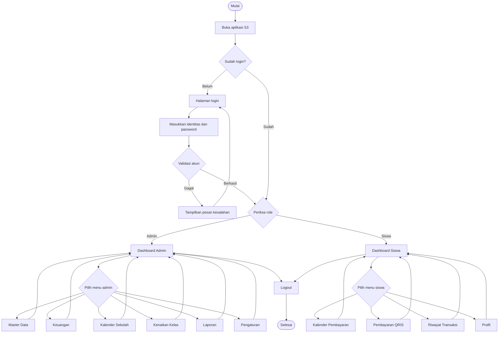

## 2.2 Flowchart autentikasi dan hak akses

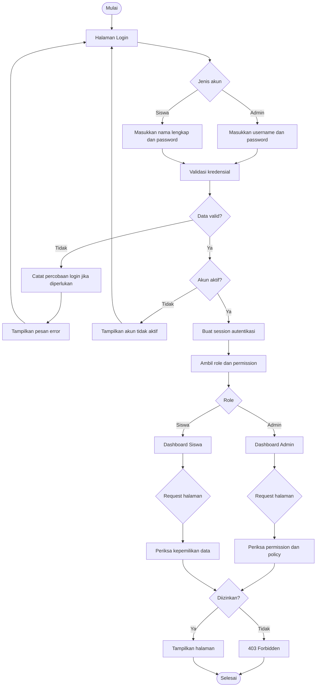

**Catatan autentikasi:**

- Admin menggunakan username dan password.
- Siswa login menggunakan **nama lengkap dan password** melalui relasi `students.user_id`.
- `students.id` adalah satu-satunya identitas internal siswa; tidak ada identitas siswa tambahan di luar `students.id`.
- Nama lengkap **tidak unik** karena dua siswa dapat memiliki nama yang sama.
- Jika terdapat nama lengkap yang sama, sistem **tidak boleh memilih akun secara acak**. Admin wajib menyediakan mekanisme identifikasi dan aktivasi akun (misalnya penetapan username unik sebagai pembeda) sehingga siswa masuk ke akun yang benar.
- Password wajib di-hash.
- Password tidak boleh disimpan dalam bentuk teks biasa.

---

# BAGIAN 3 — FLOWCHART MASTER DATA

## 3.1 Manajemen jurusan, kelas, dan tahun ajaran

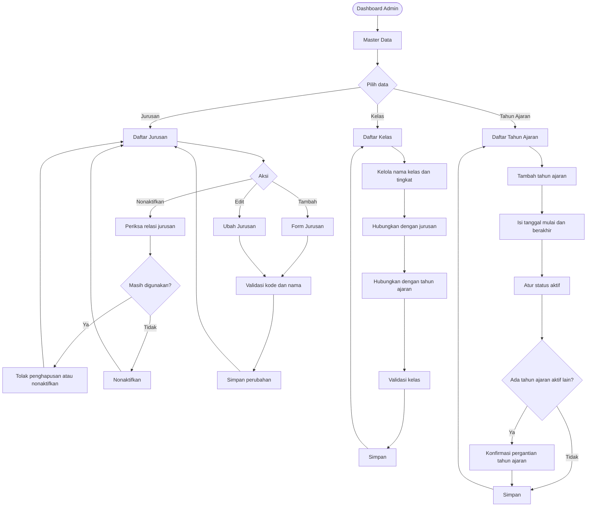

## 3.2 Manajemen siswa

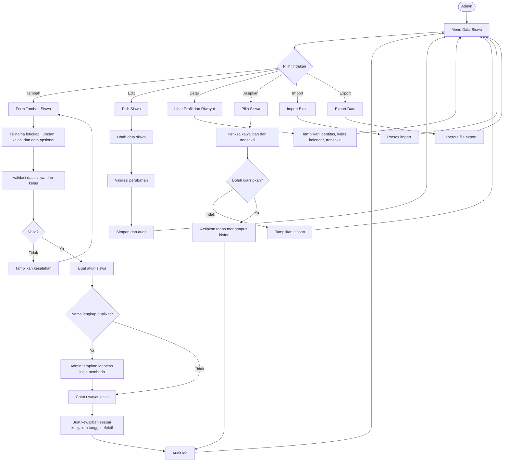

## 3.3 Flowchart import Excel

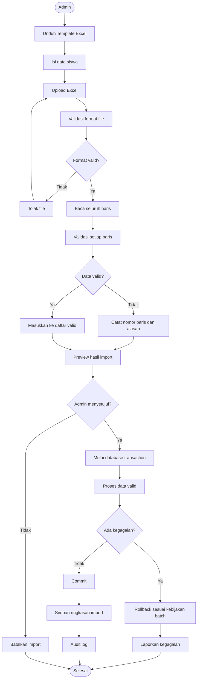

**Template import Excel:**

| Kolom | Wajib | Keterangan |
|---|---|---|
| `nama_lengkap` | Ya | Nama lengkap siswa |
| `kode_jurusan` | Ya | Kode jurusan yang tersedia |
| `kode_kelas` | Ya | Kode kelas yang tersedia |
| `tanggal_masuk` | Sesuai kebutuhan | Tanggal masuk siswa |

Template tidak memuat kolom identitas siswa. Sistem membuat `students.id` secara otomatis untuk setiap baris yang berhasil diimpor.

**Aturan import:**

- Jurusan dan kelas harus tersedia.
- Kolom wajib harus terisi.
- `tanggal_masuk` harus berupa tanggal yang valid jika diisi.
- Baris yang tidak valid harus ditampilkan berdasarkan nomor baris.
- Preview wajib ditampilkan sebelum import.
- Tidak boleh otomatis menimpa siswa yang sudah ada.
- Kemungkinan duplikat ditandai berdasarkan kombinasi nama lengkap, jurusan, kelas, dan tanggal masuk; admin memutuskan melalui preview.
- Password dibuat melalui proses aktivasi akun yang aman oleh admin.
- Simpan riwayat batch import.

---

# BAGIAN 4 — FLOWCHART KALENDER DAN KEWAJIBAN HARIAN

## 4.1 Pembuatan kalender kewajiban

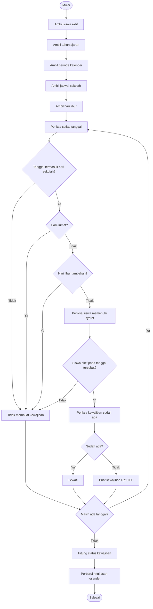

## 4.2 Aturan kalender

Status kalender harus dibedakan menjadi:

| Status | Arti |
|---|---|
| Lunas | Kewajiban telah dibayar penuh |
| Belum lunas | Kewajiban masih memiliki kekurangan |
| Sebagian | Sudah menerima alokasi tetapi belum lunas |
| Libur | Tidak ada kewajiban |
| Belum berlaku | Siswa belum aktif atau belum memenuhi syarat pada tanggal tersebut |

Status menunggu pembayaran QRIS ditampilkan sebagai status transaksi, bukan sebagai status lunas pada kalender.

## 4.3 Flowchart perhitungan status kalender

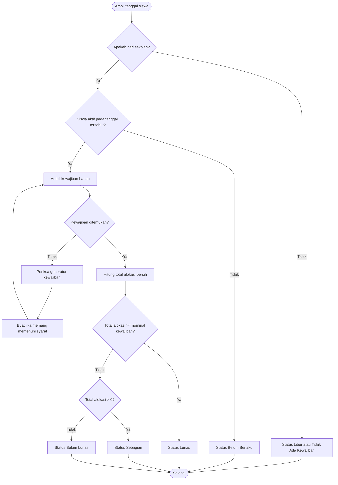

---

# BAGIAN 5 — FLOWCHART PEMBAYARAN

## 5.1 Mekanisme alokasi pembayaran bersama

Ini merupakan bagian terpenting aplikasi.

Pembayaran tunai dan QRIS harus memanggil proses alokasi yang sama.

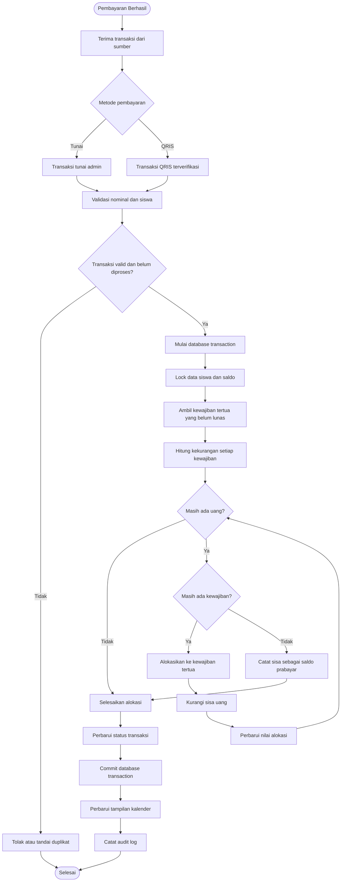

## 5.2 Contoh alokasi

Misalnya siswa mempunyai:

| Tanggal | Kewajiban | Sudah dibayar | Kekurangan |
|---|---:|---:|---:|
| 13 Nov | Rp1.000 | Rp0 | Rp1.000 |
| 14 Nov | Rp1.000 | Rp0 | Rp1.000 |
| 15 Nov | Rp1.000 | Rp0 | Rp1.000 |
| 16 Nov | Rp1.000 | Rp0 | Rp1.000 |

Siswa membayar Rp3.000.

Hasil:

| Tanggal | Alokasi | Status |
|---|---:|---|
| 13 Nov | Rp1.000 | Lunas |
| 14 Nov | Rp1.000 | Lunas |
| 15 Nov | Rp1.000 | Lunas |
| 16 Nov | Rp0 | Belum lunas |

Jika siswa membayar Rp5.000, maka Rp1.000 sisanya dicatat sebagai saldo prabayar.

Saldo prabayar bukan transaksi pembayaran baru. Saldo tersebut merupakan sisa uang dari transaksi yang sudah berhasil.

## 5.3 Flowchart pembayaran tunai

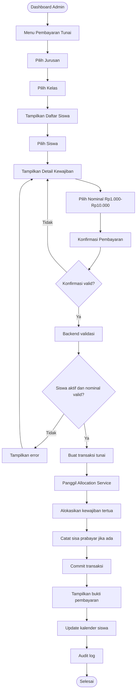

## 5.4 Flowchart pembayaran QRIS

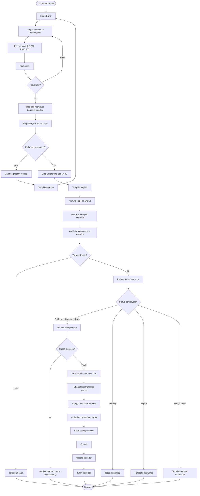

**Catatan penting:**

- QRIS yang baru dibuat tidak langsung dianggap lunas.
- Status sukses hanya boleh ditentukan setelah verifikasi backend.
- Webhook yang sama dapat dikirim lebih dari sekali.
- Webhook berulang tidak boleh mengalokasikan pembayaran dua kali.
- Gunakan identitas event atau referensi transaksi untuk idempotency.
- Jika webhook terlambat, gunakan proses rekonsiliasi status transaksi.
- Jangan membatalkan transaksi yang sudah sukses hanya karena frontend menampilkan timeout.

## 5.5 Flowchart pembatalan dan koreksi transaksi

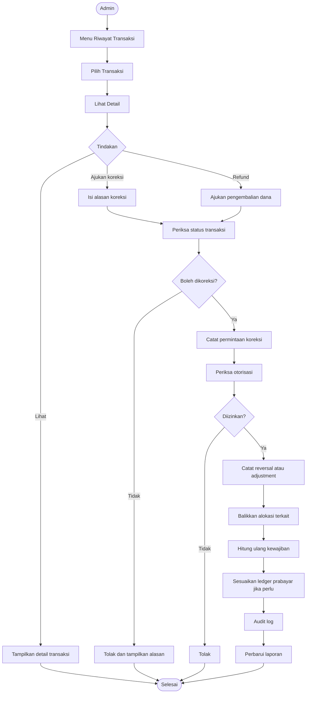

---

# BAGIAN 6 — FLOWCHART SALDO PRABAYAR

## 6.1 Penggunaan saldo prabayar

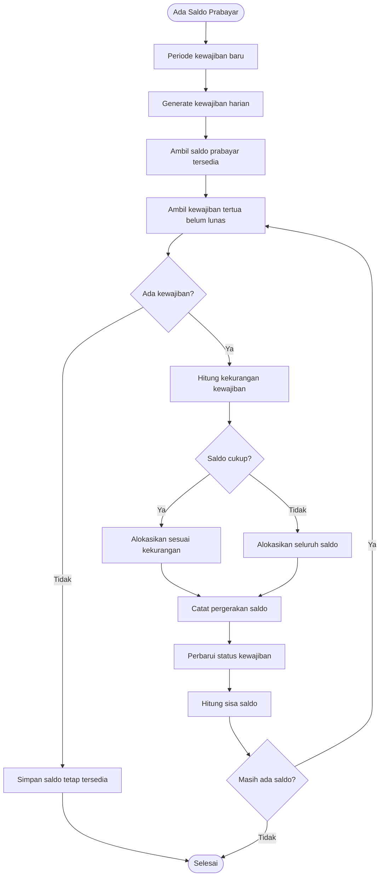

Saldo prabayar wajib dicatat sebagai ledger. Jangan hanya menyimpan angka saldo yang dapat berubah tanpa riwayat.

---

# BAGIAN 7 — FLOWCHART KENAIKAN KELAS DAN KELULUSAN

## 7.1 Kenaikan kelas massal

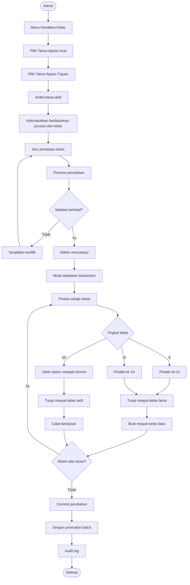

## 7.2 Kenaikan kelas individual

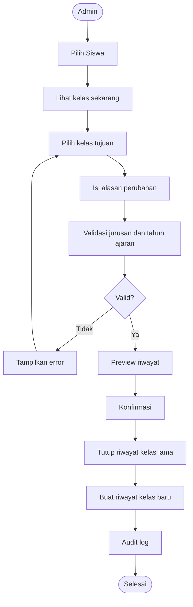

## 7.3 Kelulusan

Ketika siswa kelas XII lulus:

- Status siswa menjadi `graduated`.
- Tanggal kelulusan dicatat.
- Riwayat kelas terakhir tetap tersimpan.
- Akun siswa dapat dinonaktifkan sesuai kebijakan.
- Transaksi dan kalender historis tetap dapat dilihat admin.
- Siswa tidak lagi menerima kewajiban baru setelah tanggal efektif kelulusan.

---

# BAGIAN 8 — FLOWCHART LAPORAN DAN AUDIT

## 8.1 Laporan keuangan

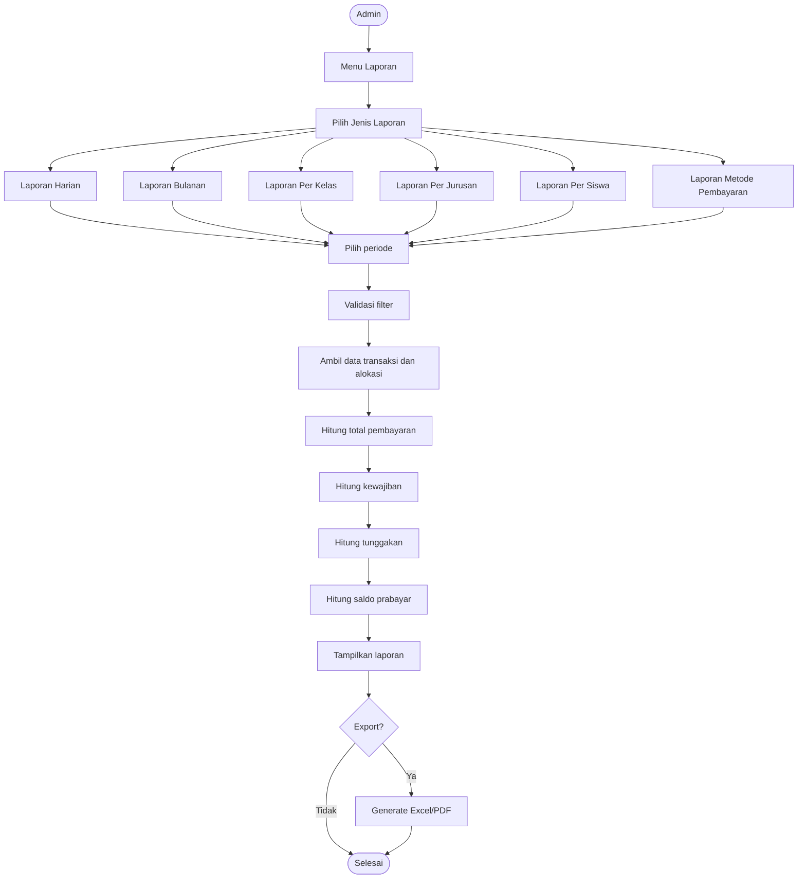

## 8.2 Audit log

Audit log harus mencatat tindakan penting, misalnya:

- Penambahan siswa.
- Perubahan data siswa.
- Pengarsipan siswa.
- Import Excel.
- Kenaikan kelas.
- Perubahan kalender.
- Pencatatan tunai.
- Koreksi transaksi.
- Reversal.
- Perubahan pengaturan pembayaran.
- Perubahan hak akses.

Setiap catatan audit sebaiknya memiliki:
- Pengguna yang melakukan tindakan.
- Jenis tindakan.
- Entitas yang berubah.
- ID entitas.
- Data sebelum perubahan jika aman disimpan.
- Data sesudah perubahan jika aman disimpan.
- Waktu.
- IP atau informasi request yang relevan.

Jangan menyimpan password, secret key, token, atau data sensitif di audit log.

---

# BAGIAN 15 — SKENARIO PENGUJIAN WAJIB

## Skenario 1 — Pembayaran normal

Kondisi:
- Tiga kewajiban belum lunas.
- Siswa membayar Rp3.000.

Hasil:
- Ketiga kewajiban lunas.
- Tidak ada saldo prabayar.

## Skenario 2 — Pembayaran berlebih

Kondisi:
- Tiga kewajiban belum lunas.
- Siswa membayar Rp5.000.

Hasil:
- Tiga kewajiban lunas.
- Saldo prabayar Rp2.000.

## Skenario 3 — Pembayaran sebagian

Kondisi:
- Siswa memiliki kewajiban Rp1.000.
- Terdapat pembayaran Rp500 yang diizinkan oleh proses koreksi atau sumber pembayaran yang mendukung nominal parsial.

Hasil:
- Status kewajiban menjadi sebagian.
- Kekurangan tetap tercatat.

Catatan: nominal pilihan pembayaran normal tetap Rp1.000 sampai Rp10.000. Skenario parsial terutama menguji mekanisme alokasi dan koreksi.

## Skenario 4 — Pembayaran QRIS pending

Kondisi:
- Siswa membuat QRIS Rp3.000.
- Pembayaran belum dilakukan.

Hasil:
- Transaksi pending.
- Kalender tidak berubah.
- Tidak ada alokasi.

## Skenario 5 — Webhook berulang

Kondisi:
- Midtrans mengirim event sukses yang sama dua kali.

Hasil:
- Transaksi hanya diproses sekali.
- Kalender tidak mengalami pembayaran ganda.

## Skenario 6 — Hari Jumat

Kondisi:
- Tanggal yang diperiksa adalah Jumat.

Hasil:
- Tidak ada kewajiban harian.
- Kalender menampilkan libur.

## Skenario 7 — Kenaikan kelas

Kondisi:
- Siswa berada di X RPL.

Hasil:
- Siswa berpindah ke XI RPL pada tahun ajaran berikutnya.
- Riwayat lama tetap tersedia.
- Transaksi lama tidak berubah.

## Skenario 8 — Siswa lulus

Kondisi:
- Siswa berada di XII RPL.

Hasil:
- Status menjadi graduated.
- Riwayat pembayaran tetap tersedia.
- Kewajiban baru tidak dibuat setelah tanggal efektif kelulusan.

## Skenario 9 — Dua pembayaran bersamaan

Kondisi:
- Dua request pembayaran masuk hampir bersamaan untuk siswa yang sama.

Hasil:
- Tidak ada alokasi melebihi kewajiban.
- Tidak ada saldo ganda.
- Setiap transaksi tercatat secara konsisten.

## Skenario 10 — Import data duplikat

Kondisi:
- File Excel berisi data siswa yang berpotensi duplikat (nama lengkap, jurusan, kelas, dan tanggal masuk sama dengan data yang sudah ada).

Hasil:
- Sistem menandai baris sebagai kemungkinan duplikat.
- Baris bermasalah ditampilkan pada preview.
- Siswa lama tidak tertimpa tanpa persetujuan admin.

## Skenario 11 — Login siswa dengan nama duplikat

Kondisi:
- Dua siswa memiliki nama lengkap yang sama.

Hasil:
- Sistem tidak memilih akun secara acak.
- Admin telah menetapkan identitas login pembeda melalui mekanisme aktivasi akun.
- Siswa masuk ke akun yang benar.
